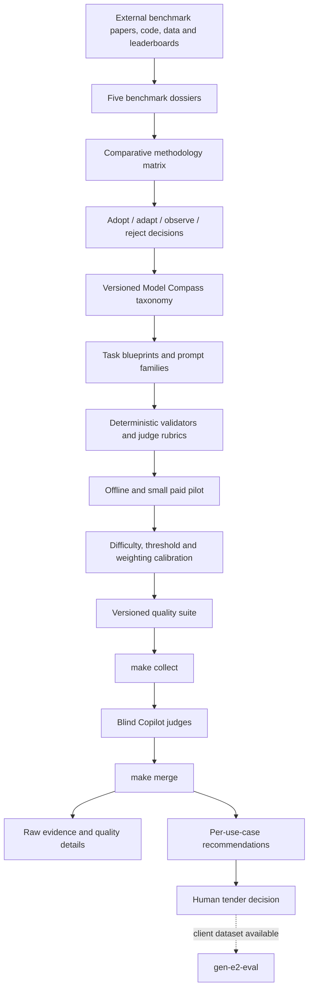

# Implementation Plan: 01 — Model Compass benchmark research and development

## Story

As the Model Compass team, we want a defensible, reproducible evaluation methodology for selecting LLMs across generic enterprise use cases, so that recommendations are based on explicit evidence rather than arbitrary prompt choices, weights, or thresholds.

The work must begin with a structured study of five recognized benchmark families and then translate the useful parts of those methods into a deliberately smaller, auditable Model Compass suite. The final pipeline must remain generic: it does not ingest a tender, client criteria, client data, or a confidential business workflow. A human who knows the tender uses the report to make the final selection.

## Current context

The repository already contains a working three-phase pipeline:

```text
make collect -> @judge-coordinator -> make merge
```

The current quality implementation is a generic internal screen:

- `data/prompts/quality_prompts.json` contains 16 internally authored prompts;
- `src/evaluators/quality_judge.py` collects responses and runs deterministic checks before sending undecidable items to the three blind Copilot judges;
- `src/evaluators/deterministic_eval.py` handles objective JSON, syntax, exact-answer, and format checks;
- `src/evaluators/quality_metrics.py` aggregates scores by dimension and publishes coverage, stability, provenance, and judge disagreement;
- `src/evaluators/recommendation.py` currently maps those prompts to six provisional generic use cases and applies provisional thresholds;
- `data/catalog/model_compass_use_cases.json` is the current versioned catalog, but its thresholds and prompt coverage have not yet been calibrated against an external benchmark study or representative task set;
- `src/main.py` produces the existing benchmark summary and a separate recommendation artifact under `results/recommendations/`;
- `dashboard/` and `scripts/export_dashboard_html.py` already expose the current recommendation artifact;
- `gen-e2-eval` remains the place for client-specific acceptance when a client dataset and workflow are available.

The main methodological risk is therefore not missing orchestration. It is choosing categories, tasks, rubrics, thresholds, and aggregation rules that are relevant to enterprise consulting without turning public benchmark scores into false precision.

## Objectives and non-goals

### Objectives

1. Build an evidence-backed research record for five recognized benchmark families.
2. Identify which benchmark design choices are useful for Model Compass and which are not transferable.
3. Define a stable, versioned generic use-case taxonomy for a technology consulting context.
4. Define task specifications, prompt families, scoring rubrics, judge protocols, thresholds, and evidence contracts.
5. Implement the next quality-suite version without silently changing the semantics of historical runs.
6. Calibrate the suite empirically with repeated runs, multiple providers, and sensitivity analysis.
7. Publish recommendations that remain traceable to task, rubric, suite version, raw response, and aggregation method.

### Non-goals

- Reproducing all five external benchmarks in full.
- Claiming official certification, leaderboard equivalence, or benchmark ownership.
- Combining incompatible public scores into one numerical average.
- Building an automatic DCE/CCTP/tender parser.
- Evaluating client-confidential data in the generic pipeline.
- Replacing `gen-e2-eval` for domain acceptance.
- Adding multimodal evaluation before the text-only methodology is stable.
- Adding agent/tool-use claims before the environment contract and execution sandbox are defined.

## Recommended five-benchmark research panel

These are five complementary research tracks. The exact variant and frozen revision must be confirmed during Phase 1; the names below are the initial panel, not a decision to import their scores.

| Track | What it contributes | What we must not assume |
|---|---|---|
| **HELM** — Holistic Evaluation of Language Models | A holistic evaluation framework: scenarios, adapters, multiple metrics, provenance, and reporting beyond a single accuracy number. | HELM is a framework/ecosystem rather than one directly comparable scalar benchmark. Its scenario and metric definitions must be version-pinned before reuse. |
| **MMLU / MMLU-Pro family** | Broad academic and professional knowledge/reasoning coverage. Original MMLU reports 57 tasks and multiple-choice accuracy; the current study must compare the original and the newer variant before choosing one. | Subject accuracy is not functional enterprise-task success. Public items may have contamination, wording, language, and distribution limitations. |
| **BIG-bench, with BIG-bench Lite/Hard as practical slices** | A large, diverse task catalog with JSON and programmatic tasks, per-task metrics, task metadata, and human baselines. The original paper describes 204 tasks; BIG-bench Lite is a lower-cost 24-task subset. | A heterogeneous task collection does not automatically produce a valid aggregate ranking. The repository was archived in 2026, so the exact frozen revision and maintenance status must be recorded. |
| **MT-Bench** | Multi-turn assistant behavior across writing, roleplay, reasoning, math, coding, extraction, STEM, and humanities, with an LLM-as-a-judge protocol and human-agreement analysis. | Judge scores have position, verbosity, self-enhancement, and calibration risks. The protocol is not equivalent to deterministic correctness. |
| **SWE-bench** | Real software-engineering tasks from GitHub issues and pull requests, evaluated by editing a repository and running tests. The original dataset contains 2,294 instances from 12 Python repositories; the ecosystem also exposes Lite, Verified, multilingual, and multimodal variants. | It evaluates a model-plus-agent-plus-tools-plus-environment system, not an isolated chat model. Execution cost, repository setup, patch validity, and test quality are part of the result. |

### Source registry to create during Phase 1

The research record must use primary sources first and preserve the exact revision/date used:

- HELM: Stanford CRFM official documentation, paper, scenario/metric repository, and release metadata.
- MMLU: original paper and official evaluation repository; separately inspect MMLU-Pro paper/repository before selecting the family variant.
- BIG-bench: official paper, archived repository, task catalog, BIG-bench Lite definition, and metric documentation.
- MT-Bench: original paper, FastChat question files, judge prompt/rubric, human-vote data, and implementation revision.
- SWE-bench: original paper, official site, dataset repository, variant definitions, evaluation harness, and leaderboard metadata.

Every citation must record URL, access date, commit/tag/version, license, and whether the source is normative, descriptive, or leaderboard-only.

## Research questions shared by all five benchmarks

Each benchmark dossier must answer the same questions so that the comparison is structural rather than anecdotal.

### A. Purpose and construct validity

- What capability or construct is being measured?
- Is the construct a capability, a task outcome, a preference, a safety behavior, or a system workflow?
- Who is the intended decision-maker and what decision does the score support?
- What does the benchmark explicitly not measure?
- Is the benchmark measuring an isolated model or a model in an agent/environment loop?

### B. Task and category design

- What is the taxonomy of categories, domains, skills, or scenarios?
- How were categories selected and who authored them?
- How many tasks/items exist in the full and recommended subsets?
- What are the difficulty levels and how are they assigned?
- Are categories mutually exclusive, overlapping, hierarchical, or merely descriptive?
- Are there business-relevant categories for consulting: documents, extraction, coding, analysis, communication, planning, multilingual work, and tool use?
- What is the unit of evaluation: question, conversation, repository issue, trajectory, patch, or pairwise battle?

### C. Test protocol

- Zero-shot, few-shot, chain-of-thought, system prompt, or custom instruction?
- Single-turn, multi-turn, tool use, code execution, retrieval, or agent loop?
- What context length, temperature, sampling, retry, and stopping rules are used?
- What model API assumptions or harness assumptions exist?
- Does the benchmark permit provider-specific prompt formatting?
- Is the test deterministic, repeated, sampled, or paired?
- What is the cost and runtime per model?

### D. Scoring and aggregation

- What is the item-level metric: exact match, normalized match, pass/fail tests, rubric score, pairwise win, ELO, calibration, or another metric?
- How are multiple valid answers handled?
- How are partial credit, abstention, refusal, malformed output, and execution errors handled?
- What is the baseline: random, human, majority, reference model, or none?
- How are categories aggregated: macro-average, micro-average, weighted average, geometric mean, rank aggregation, or separate reporting?
- Are confidence intervals, standard errors, bootstrap intervals, or repeated-run variance reported?
- How are ties handled?
- Are judge disagreement and inter-rater agreement published?
- Is a single aggregate score actually justified?

### E. Data quality and contamination

- How were items authored, reviewed, filtered, and versioned?
- Is the test set public, private, dynamic, or refreshed?
- What contamination or memorization evidence exists?
- Are train/test splits and temporal cutoffs documented?
- Are language, cultural, demographic, or domain biases measured?
- Are adversarial examples, ambiguous items, or broken references tracked?
- What is the policy for correcting an item after publication?

### F. Reproducibility and operational cost

- Is the data downloadable and redistributable?
- Is the harness open source?
- Can the test be run through OpenRouter with the current client?
- Does it require local model weights, GPUs, Docker, external services, or licensed data?
- Can we reproduce a result from the published artifacts?
- What metadata must be saved to compare runs over time?
- What is the minimum viable subset for a paid, repeatable Model Compass run?

### G. Transfer decision

For each benchmark, classify every relevant method as:

- **Adopt**: directly useful for Model Compass after adaptation.
- **Adapt**: useful principle, but not the original task or score.
- **Observe**: useful research signal, not yet implementable.
- **Reject**: incompatible with the generic OpenRouter decision-support scope.

No external benchmark score may enter the Model Compass weighted recommendation unless the research record explicitly proves comparable construct, protocol, scale, and evidence.

## Phase 0 — Freeze the baseline and research contract

### Purpose

Create a stable methodological baseline before changing prompts or scores.

### Tasks

1. Record the current code and artifact contracts:
   - current quality prompt suite hash;
   - current catalog version `model-compass-use-cases-v1`;
   - current recommendation columns and statuses;
   - current security profile and scored categories;
   - current cost profile and performance columns;
   - current judge-agent versions and rubric files.
2. Freeze the legacy quality suite as `generic-screen-v1`.
3. Define the new suite versioning rule:
   - prompt/item changes increment the suite version and hash;
   - rubric changes increment the rubric version;
   - category mapping changes increment the catalog version;
   - scoring/aggregation changes increment the methodology version.
4. Add a research source registry schema with source URL, revision, access date, license, and evidence status.
5. Define the separation between:
   - external benchmark evidence;
   - Model Compass design decisions;
   - implementation tests;
   - empirical calibration results.

### Deliverables

- `docs/research/benchmark-source-registry.md`
- `docs/research/methodology-baseline.md`
- An ADR or section in the implementation plan explaining why legacy scores remain immutable.

### Exit criteria

- A reviewer can reproduce which suite generated any historical result.
- No new external benchmark score is mixed into the current recommendation layer.
- The research panel and source-version policy are approved.

## Phase 1 — Study the five recognized benchmarks

This is the main research phase. It must be completed before redesigning the Model Compass catalog.

### Deliverable structure for each dossier

Create one dossier per benchmark under `docs/research/benchmarks/`:

- `helm.md`
- `mmlu-family.md`
- `big-bench.md`
- `mt-bench.md`
- `swe-bench.md`

Each dossier must contain:

1. Executive summary.
2. Primary sources and frozen revisions.
3. Intended construct and decision use.
4. Category/task taxonomy.
5. Dataset composition and item format.
6. Prompting and execution protocol.
7. Scoring at item, category, and aggregate levels.
8. Baselines and human agreement, if available.
9. Treatment of invalid, missing, unsafe, abstaining, and partial outputs.
10. Repetition, variance, confidence, and tie behavior.
11. Contamination, leakage, bias, and validity risks.
12. Runtime, infrastructure, cost, and licensing constraints.
13. What Model Compass should adopt, adapt, observe, or reject.
14. At least three concrete implications for our own prompt/rubric design.
15. Open questions and facts requiring a second source.

### Track 1 — HELM

Research in depth:

- scenario definition and scenario adapters;
- holistic metric families, including accuracy and non-accuracy dimensions such as robustness, fairness, bias, toxicity, and efficiency;
- how prompts, models, metrics, and scenario metadata are separated;
- how results are reported without collapsing all dimensions into one score;
- reproducibility and provenance conventions;
- whether HELM scenarios can inform our catalog schema rather than be copied as tests.

Decision to make:

- whether Model Compass should adopt a HELM-like scenario/metric separation;
- which holistic dimensions belong in quality, security, or a separate evidence axis;
- whether external benchmark results should remain a research appendix rather than a ranking input.

Expected transfer: **Adapt** the scenario/metric/provenance model; do not import a universal HELM aggregate.

### Track 2 — MMLU / MMLU-Pro family

Research in depth:

- original 57-subject taxonomy and the exact multiple-choice item format;
- subject-level accuracy, macro aggregation, few-shot protocol, and random baseline;
- differences between original MMLU and MMLU-Pro in difficulty, answer options, contamination concerns, and reporting;
- domain imbalance and whether subject averages reflect enterprise usefulness;
- sensitivity to prompt formatting and answer extraction;
- whether legal, medical, computer science, mathematics, and humanities subjects map to consulting use cases.

Decision to make:

- select original MMLU, MMLU-Pro, a small licensed-inspired internal variant, or no direct reuse;
- define whether knowledge tests are a distinct use case or only a supporting diagnostic;
- decide how to report subjects without pretending subject accuracy equals business correctness.

Expected transfer: **Adapt** subject-level reporting and deterministic multiple-choice scoring; do not treat a broad knowledge average as a functional recommendation.

### Track 3 — BIG-bench / BIG-bench Lite / Hard

Research in depth:

- full task catalog structure and keyword taxonomy;
- JSON versus programmatic task contracts;
- BIG-bench Lite composition and why a smaller subset is used operationally;
- metric registry, preferred score, multiple valid targets, and target-score formats;
- human expert baselines and task-level variance;
- task review criteria, canary strings, leakage protection, and task contribution workflow;
- maintenance status and archived repository implications as of the research date.

Decision to make:

- whether to borrow a task metadata schema and per-task metric registry;
- whether Model Compass needs a small diverse diagnostic set similar to Lite;
- how to avoid an unreviewed grab-bag of tasks and arbitrary aggregate weights.

Expected transfer: **Adapt** task metadata, metric declarations, and per-task reporting; do not import the full heterogeneous catalog without a construct map.

### Track 4 — MT-Bench

Research in depth:

- eight broad category families and the two-turn question structure;
- question authoring and expert-vote evidence;
- judge prompt, 1-10 scoring rubric, reference answers, and judge aggregation;
- single-answer scoring versus pairwise comparison and how the benchmark reports them;
- position, verbosity, self-enhancement, and judge capability bias;
- human/judge agreement and how judge model choice changes results;
- sensitivity to model identity leakage and response ordering.

Decision to make:

- whether open-ended business communication needs a small multi-turn suite;
- whether to retain rubric scoring, pairwise scoring, or both;
- how to calibrate and audit our Copilot judges before using them for recommendations.

Expected transfer: **Adapt** multi-turn category design and explicit rubric criteria; retain our raw evidence and disagreement fields; do not assume LLM judge scores are objective.

### Track 5 — SWE-bench

Research in depth:

- issue/PR instance construction and repository snapshot requirements;
- task input, model/agent interaction, patch generation, and test execution;
- original, Lite, Verified, multilingual, and multimodal variants;
- resolution rate definition and patch/test validity;
- environment and agent effects, issue difficulty, flaky tests, and repository bias;
- compute/runtime/cost requirements and why the benchmark is not equivalent to code-generation prompts;
- which parts can be represented in a safe, bounded OpenRouter experiment.

Decision to make:

- whether code generation is one generic category or several: synthesis, debugging, refactoring, repository change, test repair;
- whether Model Compass should include a lightweight code task now and defer repository-level tasks to a separate suite;
- whether SWE-bench evidence should be linked as external context rather than collected through the generic pipeline.

Expected transfer: **Adapt** execution-based pass/fail thinking and repository-level construct separation; do not claim SWE-bench performance from a single-function prompt.

## Phase 2 — Comparative synthesis and design decisions

### Purpose

Turn five dossiers into explicit choices for Model Compass rather than a literature summary.

### Deliverables

Create:

- `docs/research/benchmark-comparison.md` — normalized comparison matrix;
- `docs/research/model-compass-design-principles.md` — adopted principles;
- `docs/adr/0002-benchmark-informed-evaluation-methodology.md` — binding decisions;
- `docs/research/benchmark-to-use-case-mapping.md` — traceability from external construct to internal category.

### Comparison matrix columns

| Area | Required comparison |
|---|---|
| Construct | Capability, preference, safety, or system outcome |
| Unit | Item, dialogue, task, repository issue, trajectory |
| Taxonomy | Categories, hierarchy, coverage, overlap |
| Protocol | Zero/few-shot, system prompt, turns, tools, execution |
| Metric | Exact, normalized, tests, rubric, pairwise, ELO |
| Aggregation | Macro/micro/weighted/separate dimensions |
| Uncertainty | Repetitions, CI, inter-rater, judge disagreement |
| Data risk | Contamination, leakage, broken references, bias |
| Cost | API calls, tokens, runtime, infrastructure |
| Transfer | Adopt, adapt, observe, reject |

### Binding design principles to decide

1. **No benchmark-score fusion by default.** External scores are contextual evidence, not weighted inputs.
2. **One construct per task family.** A task must not simultaneously claim to test content, formatting, and style unless those outputs are intentionally separated.
3. **Per-task raw evidence is mandatory.** Every aggregate must resolve to prompt, response, expected answer/rubric, score, judge, and version.
4. **Category-level reporting precedes global ranking.** A global score is allowed only after category coverage and comparability are demonstrated.
5. **Quality thresholds are calibrated, not guessed.** Thresholds require item difficulty evidence, repeat runs, and a documented decision rule.
6. **Technical failures are not model failures.** Preserve the current repository invariant.
7. **Open-ended judge scores are evidence with uncertainty.** Publish judge disagreement, rubric version, and judge protocol.
8. **Model-only cost remains separate from solution TCO.** Do not import infrastructure cost into the generic recommendation without a new scope decision.
9. **Security remains its own evidence axis.** Do not hide security failures inside a quality average.
10. **Variant and version are first-class.** A result from MMLU-Pro, BIG-bench Lite, or SWE-bench Verified must never be labelled as the parent benchmark without the variant.

### Exit criteria

- Each of the five benchmarks has a documented transfer decision.
- The team has explicitly selected the constructs to implement, defer, and reject.
- No unresolved ambiguity remains about whether a score is item-level, category-level, or system-level.
- An ADR records the decision and alternatives considered.

## Phase 3 — Define the Model Compass use-case taxonomy

### Purpose

Replace the provisional six-category catalog with a taxonomy justified by enterprise consulting use cases and the benchmark synthesis.

### Candidate taxonomy to evaluate

This is a hypothesis for research, not a final list:

1. General conversation and assistance.
2. Business communication and concise writing.
3. Document question answering and grounded response.
4. Structured extraction and schema-constrained output.
5. Summarization and synthesis.
6. Classification, routing, and prioritization.
7. Translation and multilingual transformation.
8. Code generation and small code transformation.
9. Code debugging, test writing, and repository change.
10. Reasoning, planning, and decision support.
11. Data analysis and tabular interpretation.
12. RAG-oriented answer generation.
13. Bounded multi-turn assistant behavior.
14. Agent/tool-use tasks, only if a stable harness is available.

### Taxonomy decision procedure

For each candidate category:

- define the user intent and expected enterprise value;
- identify the external benchmark evidence supporting its relevance;
- define the smallest test construct that represents it;
- identify whether it is model-only or system/environment dependent;
- determine whether it can be evaluated through the current OpenRouter contract;
- define required evidence and failure severity;
- decide `include now`, `include later`, or `defer to gen-e2-eval`.

### Deliverable schema

Extend the catalog contract with fields such as:

```json
{
  "id": "document_qa",
  "name": "Document question answering",
  "construct": "answer grounded in supplied context",
  "benchmark_influences": ["helm", "mmlu-family", "mt-bench"],
  "prompt_family_ids": ["docqa_01", "docqa_02"],
  "languages": ["en"],
  "difficulty_levels": ["basic", "intermediate", "advanced"],
  "evaluation_methods": ["reference_answer", "grounding_check", "judge_rubric"],
  "minimum_quality_score": null,
  "threshold_status": "calibration_pending"
}
```

Do not add provisional thresholds until the calibration phase has produced evidence.

## Phase 4 — Design the internal test suite

### Purpose

Create tests that are representative, provider-neutral, versioned, and auditable without copying public benchmark items.

### Work packages

1. **Task blueprint**
   - Define item ID, use-case ID, construct, category, difficulty, language, context size, expected output, evaluator, and risk.
   - Define whether the item is public, internally authored, synthetic, or adapted.
2. **Prompt-family design**
   - Use multiple prompt families per use case, not one canonical example.
   - Include easy, medium, hard, and edge cases.
   - Avoid prompts that reward a provider-specific style or hidden system knowledge.
3. **Reference and rubric design**
   - Use exact/reference answers when correctness is objective.
   - Use structured validators when output has a schema.
   - Use rubric judges only where correctness cannot be determined programmatically.
   - Separate content, format, grounding, safety, and style dimensions.
4. **Difficulty calibration**
   - Pilot items on a broad model panel.
   - Remove ceiling/floor items that all models pass/fail.
   - Preserve hard items only when the failure mode is meaningful.
5. **Language strategy**
   - Decide whether the first release is English-only, English plus French, or multilingual by category.
   - Record language explicitly and never merge language scores without a documented aggregation policy.
6. **Security boundary**
   - Keep prompt-injection/security probes separate from functional quality items.
   - Reuse the current security evidence contract rather than embedding safety assumptions in every rubric.
7. **Data governance**
   - Confirm licenses, authorship, redistribution rights, PII absence, and benchmark contamination controls.

### Required artifacts

- `data/prompts/model_compass_quality_v2.json`
- `data/prompts/model_compass_rubrics.json`
- `data/prompts/model_compass_reference_answers.json` where applicable
- `docs/research/task-blueprint.md`
- `docs/research/prompt-authoring-guide.md`
- `tests/test_prompt_contracts.py`

### Exit criteria

- Every item has one primary construct and one evaluation method.
- Every judge-scored item has explicit criteria and a reference/rubric version.
- Every deterministic item has a tested validator.
- No item contains client data or unlicensed copied benchmark content.
- Item difficulty and expected cost are documented before a paid run.

## Phase 5 — Define scoring, uncertainty, and recommendation rules

### Proposed scoring layers

#### Item layer

Store:

- raw response and request fingerprint;
- item result and evaluator source;
- score and score scale;
- expected answer or rubric ID;
- technical error status;
- judge verdicts and disagreement;
- suite, rubric, catalog, model, and provider versions.

#### Family/category layer

For each model and use case:

- macro-average across prompt families;
- publish per-family scores;
- publish prompt coverage;
- publish failure counts by evaluator type;
- publish repeated-run stability;
- publish confidence intervals or bootstrap intervals when sample size permits.

#### Recommendation layer

Keep the current two-stage rule:

```text
quality eligibility first
    -> weighted comparison only among eligible models with complete evidence
    -> dense rank; ties remain ties
    -> human interprets the result
```

Before finalizing the formula, run sensitivity analysis for:

- equal weights versus 50/25/20/5;
- macro versus micro averaging;
- threshold movement by ±0.25 score points;
- removal of one category;
- one judge removed or perturbed;
- cost/performance normalization choices;
- missing evidence and technical failure rates.

### Statistical and decision requirements

- Use repeated runs for threshold calibration; do not use a single stochastic run to define a hard gate.
- Report confidence/uncertainty whenever item count allows it.
- Do not claim that a rank difference is meaningful without a practical significance rule.
- Define a minimum separation or tie band before ranking.
- Preserve exact equality and near-tie diagnostics; do not add provider/model-name tie-breakers.
- Run bootstrap or paired resampling at the item level where appropriate.
- Keep external benchmark scores in a separate evidence table unless comparability is proven.

### Deliverables

- `docs/research/scoring-methodology.md`
- `docs/research/threshold-calibration-protocol.md`
- `docs/research/sensitivity-analysis-plan.md`
- `docs/adr/0003-scoring-and-thresholds.md`
- Updated catalog schema and recommendation artifact schema.

## Phase 6 — Implement the versioned quality suite without breaking legacy runs

### File changes

- `src/evaluators/quality_judge.py` — load task metadata, language, difficulty, evaluator type, and versions while preserving raw responses and legacy compatibility.
- `src/evaluators/deterministic_eval.py` — add only validators backed by explicit contracts; test every validator independently.
- `src/evaluators/quality_metrics.py` — add family/category aggregation, coverage, uncertainty, and stability without changing legacy columns for historical artifacts.
- `src/evaluators/recommendation.py` — consume the new category-level evidence and prevent incomplete evidence from receiving a rank.
- `src/main.py` — carry suite/rubric/catalog versions through collect, judge, merge, manifests, and recommendation exports.
- `src/core/config.py` — add explicit suite/catalog selection and calibration mode flags; keep defaults safe and deterministic.
- `data/catalog/model_compass_use_cases.json` — replace provisional prompt ID mapping only after Phase 3 approval.
- `data/prompts/model_compass_quality_v2.json` — add the new item suite as a new version, not an in-place rewrite.
- `tests/test_quality_judge.py` — contract and metadata tests.
- `tests/test_quality_metrics.py` — aggregation, coverage, uncertainty, and stability tests.
- `tests/test_quality_pipeline.py` — end-to-end merge and provenance tests.
- `tests/test_recommendation.py` — threshold, missing evidence, tie, and sensitivity tests.

### Compatibility rules

- Keep `generic-screen-v1` readable.
- Never rewrite old `benchmark_*.csv/json` artifacts.
- Keep `quality_suite_id`, `catalog_version`, `rubric_version`, and `methodology_version` explicit.
- Reject merge when collect-time and merge-time suite/catalog versions disagree.
- Export new recommendation details as a sibling artifact rather than changing the one-row-per-model summary shape unexpectedly.

## Phase 7 — Research-to-code pilot

### Purpose

Validate the proposed methodology offline and on a small, controlled model panel before a full paid run.

### Pilot design

- Select 5–8 representative OpenRouter models across providers, sizes, open/proprietary status, and price tiers.
- Run `make dry-run` with synthetic responses for all validators.
- Run `make verify` against the live catalog before paid collection.
- Run one small paid collection with `QUALITY_REPETITIONS >= 3` for calibration items.
- Complete the full judge phase with all three judges.
- Merge, export HTML, inspect raw evidence, and record cost/latency.

### Pilot analysis

- Check item pass rates and category ceiling/floor effects.
- Check whether categories discriminate between models without becoming provider proxies.
- Compare deterministic and judged components separately.
- Inspect judge disagreement and self-identification leakage.
- Compare score stability across repetitions.
- Test recommendation sensitivity to weights and thresholds.
- Compare the internal category profile to the five external benchmark constructs without comparing raw scores.

### Exit criteria

- No critical validator or provenance defect.
- Every item has complete evidence or an explicit technical failure.
- Threshold candidates are supported by distributions and review notes.
- Recommendation status is stable under documented small perturbations.
- Budget and runtime are acceptable for a full research run.

## Phase 8 — Empirical validation and comparison with `gen-e2-eval`

### Research run

Run a controlled panel with enough models to expose provider, size, price, and capability differences. Use a fixed model manifest, fixed OpenRouter snapshot, fixed suite/rubric/catalog versions, and repeated attempts.

### Analyses

1. **Reliability** — repeated-run stability by item, category, and model.
2. **Discrimination** — score variance and ceiling/floor rates.
3. **Convergent evidence** — compare category-level results with the relevant external benchmark constructs.
4. **Predictive usefulness** — compare Model Compass recommendations against `gen-e2-eval` outcomes on the same models where a client dataset exists.
5. **Ranking stability** — bootstrap rank intervals, tie frequency, and sensitivity to weights.
6. **Failure analysis** — inspect disagreements, false positives, false negatives, malformed outputs, and judge disagreement.
7. **Cost/latency trade-off** — verify that recommendation outcomes are not dominated by normalization artifacts.
8. **Security independence** — verify that functional quality remains separate from RSI and leakage evidence.

### Deliverables

- `docs/research/validation-report-v1.md`
- `docs/quality-validation/model-compass-gen-e2-comparison.md`
- benchmark run manifest and immutable artifacts;
- issue list for invalid/ambiguous/low-discrimination items;
- recommendation of `accept`, `revise`, or `reject` for each use case.

## Phase 9 — Productionization and governance

### Operational requirements

- Version every suite, catalog, rubric, methodology, and model manifest.
- Pin or record benchmark source revisions and external benchmark variants.
- Publish a run manifest with checksums for pending, judge, benchmark, recommendation, and evidence files.
- Keep raw responses and technical errors separate.
- Make dashboards display source versions and evidence coverage.
- Add a change review for every prompt, rubric, threshold, or aggregation change.
- Add a deprecation policy for benchmark variants and catalog entries.
- Maintain a changelog entry for every user-visible methodology change.
- Keep a research ledger of cost, runtime, model availability, and known provider changes.

### Release gates

A Model Compass methodology release is allowed only when:

- all tests, lint, type-check, and strict docs build pass;
- the full research and source registry is complete;
- all included categories have task and scoring specifications;
- calibration evidence supports each threshold;
- recommendation sensitivity is documented;
- legacy artifact compatibility is verified;
- the release report states what the system does and does not measure.

## Architecture and data flow



### Core data contracts to establish

```text
BenchmarkSource
  id, family, variant, source_url, revision, accessed_at, license, status

BenchmarkFinding
  source_id, construct, category, protocol, metric, aggregation,
  evidence, limitation, transfer_decision

TaskDefinition
  item_id, use_case_id, construct, difficulty, language, prompt/messages,
  reference, rubric_id, evaluator, expected_cost, version

EvaluationEvidence
  run_id, suite_id, catalog_version, rubric_version, item_id, model,
  response, score, score_scale, evaluator, error_status, judge_verdicts,
  disagreement, request_fingerprint

RecommendationRow
  use_case_id, model, quality_score, threshold, quality_eligible,
  security_component, cost_component, performance_component,
  recommendation_score, uncertainty, rank, status, evidence_missing
```

## File changes

### To create during the plan

- [x] `docs/implementation-plans/01-model-compass-benchmark-research-and-development.md` — this plan.
- [x] `docs/research/benchmark-source-registry.md` — frozen primary sources and revisions.
- [x] `docs/research/benchmarks/helm.md` — HELM dossier.
- [x] `docs/research/benchmarks/mmlu-family.md` — MMLU/MMLU-Pro dossier.
- [x] `docs/research/benchmarks/big-bench.md` — BIG-bench/Lite/Hard dossier.
- [x] `docs/research/benchmarks/mt-bench.md` — MT-Bench dossier.
- [x] `docs/research/benchmarks/swe-bench.md` — SWE-bench dossier.
- [x] `docs/research/benchmark-comparison.md` — normalized comparison matrix.
- [x] `docs/research/model-compass-design-principles.md` — adopted/adapted/rejected principles.
- [x] `docs/research/benchmark-to-use-case-mapping.md` — external construct traceability.
- [ ] `docs/research/task-blueprint.md` — task authoring contract.
- [ ] `docs/research/prompt-authoring-guide.md` — prompt quality and review rules.
- [ ] `docs/research/scoring-methodology.md` — item/category/recommendation scoring.
- [ ] `docs/research/threshold-calibration-protocol.md` — threshold evidence and decision rules.
- [ ] `docs/research/sensitivity-analysis-plan.md` — ranking and weighting sensitivity.
- [x] `docs/adr/0002-benchmark-informed-evaluation-methodology.md` — research decisions.
- [ ] `docs/adr/0003-scoring-and-thresholds.md` — scoring and gate decisions.
- [ ] `data/prompts/model_compass_quality_v2.json` — new versioned task suite.
- [ ] `data/prompts/model_compass_rubrics.json` — rubric definitions and versions.
- [ ] `data/prompts/model_compass_reference_answers.json` — objective references where needed.
- [ ] `tests/test_prompt_contracts.py` — task and rubric schema tests.

### To modify during implementation

- [ ] `data/catalog/model_compass_use_cases.json` — approved taxonomy and calibrated thresholds.
- [ ] `src/evaluators/quality_judge.py` — task metadata and suite version propagation.
- [ ] `src/evaluators/deterministic_eval.py` — new explicit validators only.
- [ ] `src/evaluators/quality_metrics.py` — category aggregation and uncertainty.
- [ ] `src/evaluators/recommendation.py` — evidence-aware ranking and sensitivity outputs.
- [ ] `src/main.py` — collect/merge provenance and version compatibility checks.
- [ ] `src/core/config.py` — suite and calibration configuration.
- [ ] `dashboard/data_prep.py` — shared recommendation/evidence transformations.
- [ ] `dashboard/app.py` — research metadata, category evidence, and recommendation explainability.
- [ ] `scripts/export_dashboard_html.py` — static report parity.
- [ ] `docs/quality-methodology.md` — published scoring semantics.
- [ ] `docs/workflow.md` — pipeline and artifact contract.
- [ ] `README.md`, `AGENTS.md`, `CHANGELOG.md` — public scope and operational invariants.

## Task breakdown

### Research and decision tasks

1. [ ] Freeze the current legacy suite, catalog, rubric, and artifact versions.
2. [x] Create the source registry and collect primary HELM sources.
3. [x] Complete the HELM dossier with scenario, metric, provenance, and transfer analysis.
4. [x] Complete the MMLU/MMLU-Pro dossier and decide which family variant is relevant.
5. [x] Complete the BIG-bench/Lite/Hard dossier, including task metrics and maintenance status.
6. [x] Complete the MT-Bench dossier, including judge bias and human-agreement evidence.
7. [x] Complete the SWE-bench dossier, including agent/environment confounds and variants.
8. [x] Build the normalized five-benchmark comparison matrix.
9. [x] Approve the adopt/adapt/observe/reject decision for every major method.
10. [x] Record the benchmark-informed methodology decisions in ADR 0002.

### Taxonomy and test-design tasks

11. [ ] Review candidate enterprise use cases against consulting workflows and external benchmark constructs.
12. [ ] Approve the first-release taxonomy and document explicit deferrals.
13. [ ] Define the task blueprint schema and validation rules.
14. [ ] Author prompt families with difficulty, language, construct, expected cost, and evaluator metadata.
15. [ ] Author deterministic reference answers and validators for objective tasks.
16. [ ] Author judge rubrics, reference answers, and calibration examples for open tasks.
17. [ ] Run human review for ambiguity, correctness, bias, licensing, and provider neutrality.
18. [ ] Create the versioned v2 suite without modifying `generic-screen-v1`.

### Scoring and implementation tasks

19. [ ] Define category-level aggregation, uncertainty, missing evidence, tie band, and threshold rules.
20. [ ] Implement task metadata and version propagation through collect, judge, merge, and manifest.
21. [ ] Implement new deterministic evaluators with unit tests and malformed-output behavior.
22. [ ] Extend quality aggregation with per-family results, coverage, stability, and uncertainty.
23. [ ] Update recommendation scoring to require quality eligibility and complete evidence.
24. [ ] Add sensitivity analysis for weights, thresholds, categories, and judge perturbations.
25. [ ] Add dashboard and static-export views for task/category evidence and methodology versions.
26. [ ] Record scoring decisions in ADR 0003 and update public methodology docs.

### Pilot and validation tasks

27. [ ] Run the full offline dry-run across all task types and validators.
28. [ ] Run a small paid pilot on a diverse 5–8 model panel with at least three repetitions.
29. [ ] Analyze item discrimination, ceiling/floor effects, judge disagreement, and stability.
30. [ ] Calibrate thresholds and document the evidence supporting each threshold.
31. [ ] Run sensitivity analysis and identify unstable recommendations or artificial ties.
32. [ ] Compare Model Compass recommendations with `gen-e2-eval` where a client dataset exists.
33. [ ] Produce the validation report and accept/revise/reject decision for each category.

### Release and governance tasks

34. [ ] Add release gates to CI and documentation checks.
35. [ ] Add source/version/catalog/rubric metadata to every decision artifact.
36. [ ] Update README, AGENTS, changelog, dashboard glossary, and workflow docs.
37. [ ] Run complete tests, lint, type-check, coverage, and `mkdocs build --strict`.
38. [ ] Publish the methodology release and archive the research evidence.

## Acceptance criteria mapping

| Acceptance criterion | Tasks |
|---|---|
| Five recognized benchmarks are studied with comparable methodology records | 2–8 |
| Each benchmark dossier covers tests, categories, scoring, aggregation, limitations, and transfer decisions | 3–7 |
| External benchmark scores are not mixed without a comparability decision | 8–10, 19, 26 |
| Model Compass taxonomy is justified by enterprise use cases and benchmark evidence | 11–12 |
| Every internal task has a construct, category, difficulty, evaluator, reference/rubric, and version | 13–18 |
| Quality content and output format remain separate | 15–16, 21–22 |
| Thresholds are calibrated from repeated empirical evidence | 19, 28–31 |
| Missing and technical evidence is explicit, never silently favorable | 19–23 |
| Legacy `generic-screen-v1` artifacts remain readable and unchanged | 1, 18, 20, 23 |
| Recommendations remain auditable and human-controlled | 20, 23, 25, 35 |
| Release passes engineering and documentation gates | 34–38 |

## Testing strategy

### Unit tests

- Validate benchmark source, task, rubric, and catalog schemas.
- Validate evaluator selection and version propagation.
- Test exact-answer, structured-output, code, rubric, malformed-output, refusal, empty-response, and technical-error cases.
- Test category aggregation, macro/micro choices, missing evidence, confidence intervals, and stability calculations.
- Test dense ties, near ties, below-threshold models, and incomplete evidence.
- Test sensitivity analysis with deterministic fixtures.

### Integration tests

- Run collect-to-merge using fake OpenRouter responses for every evaluator type.
- Verify raw response preservation and sidecar diagnostics.
- Verify all three judge outputs are required and coverage validation remains fail-fast.
- Verify suite, rubric, catalog, methodology, and model-manifest versions survive into CSV/JSON, recommendation artifacts, and run manifests.
- Verify a catalog/suite mismatch fails before merge.
- Verify Streamlit-independent transformations are identical for live and static reports.

### Empirical validation

- Use fixed model manifests and repeated runs for calibration.
- Record model/provider, prompt version, seed, temperature, retries, context, and cost.
- Calculate per-item and per-category variance.
- Use bootstrap confidence intervals where sample size supports them.
- Inspect rank stability under weight and threshold perturbations.
- Conduct human review of ambiguous items and a sample of judge-scored responses.
- Compare to external benchmark constructs and `gen-e2-eval` only at the level justified by construct compatibility.

### Required repository checks

```bash
make test-cov
make lint
make type-check
make docs-build
```

For dashboard changes, also run `make export-html` on a representative benchmark and inspect both the Streamlit and static views.

## Dependencies

- Primary benchmark papers, official repositories, task files, and frozen revisions.
- OpenRouter access for paid pilot runs; no key is needed for research or dry-run phases.
- Existing Copilot judge agents for open-ended scoring; judge prompt/rubric versions must be recorded.
- Potentially `numpy` or `scipy` for bootstrap/confidence calculations only after confirming that the current dependency policy requires them; avoid adding a library for calculations that can remain simple and deterministic.
- `gen-e2-eval` access only for optional client-dataset comparison; it is not required for generic methodology development.

## Open questions and decision gates

1. Should the five research tracks use original MMLU or MMLU-Pro as the canonical family variant?
2. Should BIG-bench research focus on the full catalog, Lite, Hard, or a deliberately sampled task set?
3. Is MT-Bench's LLM-as-a-judge protocol acceptable as a calibration reference while our own judges are provider-affiliated?
4. Should SWE-bench be deferred to a separate code-agent evaluation because it measures an environment and agent, not a bare OpenRouter chat model?
5. Is the first Model Compass release English-only, English plus French, or multilingual per category?
6. Which use cases need real documents or retrieval context, and can they remain generic without becoming a hidden client benchmark?
7. What item count per category is enough to calibrate thresholds without exceeding the budget?
8. What practical difference in score should count as a meaningful ranking difference rather than a tie?
9. Should uncertainty affect eligibility, ranking, or only reporting in the first release?
10. Which external benchmark data can be redistributed, and which should be referenced but not copied?
11. What minimum pilot model panel and repetition count are required before declaring a category valid?
12. Should agent/tool-use tasks enter Model Compass only after a separate execution sandbox and cost contract are approved?

## Rollback and evolution strategy

- Keep all existing quality and benchmark artifacts immutable.
- Introduce every new suite under a new version and file; never rewrite historical prompts in place.
- If a new category or evaluator is invalidated, mark it deprecated in the catalog and preserve its evidence for audit.
- If thresholds or weights change, create a new methodology/catalog version and rerun calibration.
- If the benchmark research does not support a category, defer it rather than filling the gap with arbitrary prompts.
- If the recommendation layer is unstable, keep publishing per-category evidence while withholding the global recommendation rank.
- A failed pilot must be recoverable by reverting the new suite/catalog version without changing the legacy pipeline.
