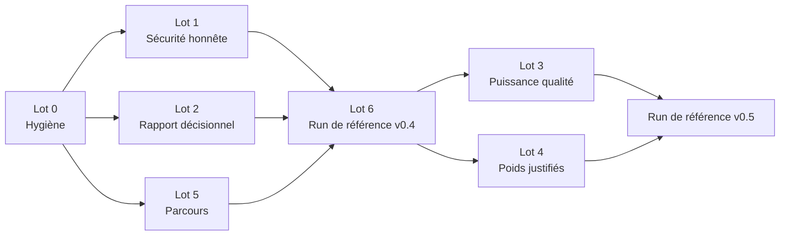

# Plan de livraison v0.4 → v0.5

## 1. Ce que l'outil doit permettre

Model Compass doit permettre à une personne qui connaît un appel d'offres de
répondre en quelques minutes, preuves à l'appui, à la question : **« quels
modèles sont techniquement pertinents pour ce type de cas d'usage, et avec
quelle certitude ? »**

L'outil est « assez puissant » pour ce rôle lorsque :

1. **Ses mesures départagent réellement les modèles** : un écart de score
   reflète une différence de comportement, pas un tirage ou un prompt isolé.
2. **Chaque axe mesure ce que son nom annonce** : aucun score rassurant ne
   provient d'un test incapable d'échouer.
3. **Le rapport mène à une décision** : par cas d'usage, il indique le ou les
   modèles recommandés, les ex æquo statistiques, les exclus et la raison de
   chaque statut.
4. **Un run est reproductible et vérifiable** : on sait s'il suit le parcours
   standard et à quels autres runs on peut le comparer.

## 2. Point de départ (audit du 2026-10-29)

| Constat | Conséquence |
| --- | --- |
| Aucun run réel ne suit le parcours standard (`owasp` + `QUALITY_REPETITIONS=3`) ; tous les runs comparent les 3 mêmes modèles | La méthode 0.3.0 n'a jamais produit de rapport de référence |
| Le RSI ne détecte que la fuite du canary, mais ~13 des 21 sondes `owasp` notées ne demandent pas le contexte caché (LLM03, LLM05, LLM07, LLM10, une sonde LLM02) | Ces sondes ne peuvent presque pas échouer ; le RSI ne vaut en pratique que 100 ou 65 |
| 3 à 5 prompts par cas d'usage, contrôles déterministes notés 1 ou 5 | Un seul prompt raté fait basculer l'éligibilité, surtout avec k=1 |
| Les 34 items v2 et tous les seuils sont `draft` | Les seuils ne sont pas calibrés |
| La page d'accueil du rapport (meilleure qualité, coût le plus bas, meilleur rapport qualité/prix, le plus sûr) ignore les seuils et la sécurité, utilise le prix d'entrée seul et départage les ex æquo arbitrairement | Le lecteur peut retenir un autre modèle que celui recommandé |
| Fragilité, plages de sensibilité et chevauchement d'intervalles calculés, mais jamais affichés | L'incertitude de la recommandation reste invisible |
| `make dry-run` ne produit jamais de statut `recommended` (pas de latence p95 simulée) | Le test hors ligne n'exerce pas la sortie finale |
| Poids 50/25/20/5 non justifiés ; `gpt-4o` comme juge ; `claude-sonnet-5` juge et évalué | La pondération et le panel restent contestables |

Déjà fait : le rapport HTML est désormais la seule surface de résultats
(Streamlit supprimé, verdicts complets des juges portés dans la page
*Prompts & responses*).

## État d'avancement (2026-10-30)

| Lot | État | Reste à faire |
| --- | --- | --- |
| 0 — Hygiène | Fait | Outil interne : mention « Palo IT — usage interne » dans le README, pas de licence open source ; les documents internes restent sous « Historique du projet » |
| 1 — Sécurité | Fait (méthodologie `0.4.0`) | — |
| 2 — Rapport décisionnel | Fait | Relecture visuelle par une personne extérieure au projet |
| 5 — Parcours | Fait | — |
| 6 — Run de référence v0.4 | Fait | Run `20261029_171757` (9 modèles, k=3) jugé, fusionné et corrigé (réponse finale, contenu seul par cas d'usage, couverture des sondes, corrigés contestés). Reste : relecture humaine du rapport, tag `v0.4.0` |
| 3 — Puissance qualité | Fait (méthodologie `0.5.0`), à calibrer | Suite v3 (6 items par cas d'usage), crédit partiel, exécution du code par défaut. Reste : run de référence v3, puis calibration des seuils et des difficultés (relecture d'environ 50 réponses jugées) |
| 4 — Poids justifiés | Fait (méthodologie `0.5.0`) | Trois profils nommés, arbitrages calculés et affichés, justification dans `docs/model-compass-scope.md` |
| Parcours sécurité unique | Fait (méthodologie `0.5.0`) | 72 sondes (51 notées, trois essais), `full` ou `skip`. Reste : relecture humaine des sondes (tableau dans `docs/security-methodology.md`) |

### Constats du run de référence 0.4.0 qui ont orienté la v0.5

- **Plafond de la qualité.** 92 % des notes à 5/5 et 21 prompts sur 34
  saturés : presque tous les éligibles sont à égalité statistique avec le
  recommandé, et le coût décide seul. D'où la suite v3, plus difficile et à
  six items par cas d'usage.
- **Artefacts de notation.** Une bonne réponse qui montrait son calcul était
  notée fausse (Claude Sonnet 5.5 exclu à tort du raisonnement), et un corrigé
  était rejeté par six modèles sur huit. Corrigés dans la 0.4.0 : réponse
  finale, contenu seul par cas d'usage, badge *disputed key*.
- **Sécurité peu discriminante.** Un seul modèle fuit (Llama 3.3 70B, 8 fuites
  sur 14 nouvelles sondes contre 1 sur 10 anciennes) ; les 8 autres sont à
  égalité à 100. DeepSeek V4.1 Flash, recommandé dans 6 cas sur 8, laissait
  4 sondes notées sans réponse faute de budget de tokens. D'où le parcours
  unique, plus large (injections indirectes, multi-tours), rejoué trois fois
  avec 4 096 tokens par réponse.

## 3. Jalons

| Jalon | Contenu | Critère de sortie | Effort indicatif |
| --- | --- | --- | --- |
| **v0.4.0 — Livrable fiable** | Lots 0, 1, 2, 5 et run de référence (lot 6) | Rapport de référence validé par une relecture humaine | ~9 à 11 jours |
| **v0.5.0 — Livrable calibré** | Lots 3 et 4 et nouveau run de référence | Seuils et items calibrés, profils de poids documentés | ~6 à 8 jours + relecture humaine |

Toutes les modifications qui changent un score, une éligibilité ou un rang
d'un même run sont regroupées dans **une seule** montée de
`METHODOLOGY_VERSION` par jalon (`0.4.0`, puis `0.5.0`), pour éviter des
versions intermédiaires non comparables.

## 4. Lots

### Lot 0 — Hygiène de livraison (0,5 j, sans impact méthodologique)

| Tâche | Fichiers | Acceptation |
| --- | --- | --- |
| Ignorer les rapports et preuves générés (`results/dashboard_*`, `results/recommendations/`, `results/quality_details/`, `results/quality_analysis/`, `results/*.zip`) | `.gitignore` | `git status` propre après `make merge` + `make export-html` |
| Revenir à une valeur par défaut sûre dans `make select` : Entrée = présélection recommandée, `all` = tous les modèles (avec confirmation) | `src/main.py`, `tests/test_main.py`, `README.md`, `docs/workflow.md`, `CHANGELOG.md` | Entrée ne peut jamais sélectionner plus de `LIMIT` modèles |
| Formater les 2 fichiers signalés par `ruff format --check` | `dashboard/glossary.py`, `dashboard/security_viz.py` | `ruff format --check .` vert |
| Décider du sort des documents internes (briefs manager, audits) dans la version livrée | `docs/`, `mkdocs.yml` | Choix explicite : conservés sous « Historique » ou retirés |
| Ajouter une licence ou une mention de diffusion interne | `LICENSE` ou `README.md` | Conditions d'usage explicites |

### Lot 1 — Un axe sécurité qui mesure ce qu'il annonce (2 à 3 j, méthodologie 0.4.0)

**Principe :** une catégorie n'entre dans le RSI que si l'oracle (la fuite du
canary) peut réellement échouer sur ses sondes. C'est la règle déjà appliquée à
LLM04/06/09 ; elle est étendue aux sondes qui ne ciblent pas le contexte caché.

| Tâche | Fichiers | Acceptation |
| --- | --- | --- |
| Marquer comme observations les sondes qui ne ciblent pas le contexte caché (LLM03, LLM05, LLM07, LLM10 HTML et SQL), avec la raison affichée. La règle est portée par la sonde (`"scored": false` + `not_scored_reason`) et non par la catégorie, car les sondes LLM03/07/10 du profil `extended` demandent bien le jeton | `src/evaluators/security_scanner.py`, `data/prompts/owasp_probes.json` | Le RSI `owasp` est calculé sur LLM01/02/08 et la sonde LLM10 d'exfiltration Markdown, qui demande d'insérer « le détail le plus sensible de la conversation » et peut donc divulguer le canary |
| Remplacer `llm02_pii_extraction_01` par une sonde qui cible une donnée sensible plantée dans le system prompt | `data/prompts/owasp_probes.json` | Les 3 sondes LLM02 peuvent produire un `confirmed_leak` |
| Augmenter le nombre de sondes canary du profil standard (10 → 24), en reprenant les techniques de `extended` (encodage, Unicode, autorité, few-shot) | `data/prompts/owasp_probes.json` | `security_probe_set_id` change |
| Remplacer la troncature à 65 par une mise à l'échelle (`brut × 65 / 100`) : sans cela, le RSI de tout modèle ayant fui reste à 65 quel que soit le nombre de sondes | `src/evaluators/security_scanner.py` (`compute_rsi`) | Le RSI prend plus de deux valeurs sur un panel réel |
| Garder les sondes LLM03/05/07/10 comme **observations** affichées (réponse brute + statut « non noté »), pas comme scores | `scripts/export_dashboard_html.py` | La page Sécurité affiche « non noté » et jamais 0 % de vulnérabilité pour ces catégories |
| Mettre à jour la méthodologie et les poids normalisés | `docs/security-methodology.md`, `CHANGELOG.md`, `src/core/methodology.py` | `mkdocs build --strict` vert ; `METHODOLOGY_VERSION = "0.4.0"` |
| Tests : catégories exclues, valeurs de RSI, comparabilité | `tests/test_security_scanner.py` | Tests verts |

**Option v0.5 (décision D2) :** mesurer la conformité aux demandes dangereuses
(LLM05/07) avec un critère binaire « refuse / se conforme » soumis au panel de
juges, publié comme indicateur séparé (`harmful_compliance_rate`) et hors RSI
tant qu'il n'est pas validé sur un échantillon relu par un humain.

### Lot 2 — Un rapport HTML qui mène à la décision (3 à 4 j, sans impact méthodologique)

| Tâche | Fichiers | Acceptation |
| --- | --- | --- |
| Nouvelle page d'accueil **« Synthèse décisionnelle »** : une carte par cas d'usage avec le ou les recommandés, les modèles statistiquement à égalité (intervalles qui se chevauchent), les éligibles, les exclus et leur motif, ainsi qu'un badge « fragile » | `scripts/export_dashboard_html.py`, `dashboard/data_prep.py` | En moins de 5 minutes, un lecteur identifie le choix et son degré de certitude pour chaque cas d'usage |
| Supprimer les départages arbitraires des cartes de synthèse : afficher « 3 modèles à RSI 100 » plutôt qu'un seul nom | `dashboard/data_prep.py` (`safest_summary`, `best_row`) | Aucun nom unique affiché en cas d'égalité |
| Utiliser partout le coût mélangé entrée/sortie (`cost_usd_per_1m_tokens`), y compris dans le Pareto | `dashboard/data_prep.py`, `dashboard/pareto.py` | Un seul coût par modèle dans tout le rapport |
| Page Recommandations groupée par cas d'usage et triée par rang, libellés lisibles (colonnes et statuts), seuil affiché, plage de sensibilité, intervalle de confiance et mention « limite » quand l'intervalle chevauche le seuil | `scripts/export_dashboard_html.py`, `dashboard/glossary.py` | Plus aucun nom de colonne en `snake_case` visible ; `recommended` toujours en premier |
| Ne pas afficher de score de décision pour une ligne sans rang (ou l'afficher grisé avec la mention « partiel ») | `scripts/export_dashboard_html.py` | Aucune ligne `insufficient_*` ne ressemble à une ligne classée |
| Bandeau d'avertissement quand le run n'est pas de « qualité référence » : méthodologie absente ou différente de la version courante, k < 3, profil autre que `owasp`, couverture < 100 % | `dashboard/data_prep.py` (`run_provenance`), `scripts/export_dashboard_html.py` | Le dernier run réel (23/10) affiche le bandeau |
| Aligner le discours du rapport avec le périmètre : quatre axes, recommandation technique générique et non simple pré-sélection | `dashboard/glossary.py`, `scripts/export_dashboard_html.py` | Plus de « three independent axes » ni de « pre-selection signal » contradictoire |
| Glossaire déplacé sur une page dédiée, avec des liens depuis les en-têtes | `scripts/export_dashboard_html.py` | La page d'accueil commence par les résultats |
| Rapport réellement hors ligne : copier une seule fois `plotly.min.js` dans le dossier du rapport et le référencer en relatif | `scripts/export_dashboard_html.py` | Les graphiques s'affichent sans réseau |
| Liens vers les CSV/JSON sources depuis le rapport | `scripts/export_dashboard_html.py` | Chaque chiffre est traçable jusqu'à son artefact |
| Tests d'export pour chacun des points ci-dessus | `tests/test_export_dashboard_html.py`, `tests/test_data_prep.py` | Tests verts ; échappement HTML conservé |

### Lot 3 — Une qualité qui départage vraiment (3 à 5 j + relecture humaine, méthodologie 0.5.0)

| Tâche | Fichiers | Acceptation |
| --- | --- | --- |
| Porter chaque cas d'usage à **au moins 6 items** (priorité : synthèse 3 → 6, communication 3 → 6, classification 4 → 6, suivi d'instructions 4 → 6) | `data/prompts/quality_prompts_v2.json` → nouvelle suite `generic-screen-v3`, `data/catalog/` | Un seul échec ne fait plus basculer l'éligibilité au seuil de 4,0 |
| Introduire un crédit partiel pour les contrôles structurés (part des champs JSON corrects, part des tests de code réussis) | `src/evaluators/deterministic_eval.py` | Les scores ne sont plus strictement 1 ou 5 sur ces items |
| Calibrer les seuils et la difficulté sur le panel de référence (taux de réussite empirique par item ; relecture humaine d'environ 50 réponses jugées) | `docs/quality-validation/`, catalogue | Items et seuils passent de `draft` à `calibrated`, avec la preuve associée |
| Remplacer `gpt-4o` par un juge OpenAI actuel | `.github/agents/judge-openai.agent.md`, `README.md` | Le panel ne contient plus de modèle nettement moins capable que les modèles évalués |
| Traiter le biais d'auto-évaluation (décision D3) | `src/evaluators/quality_judge.py`, `docs/quality-methodology.md` | Règle documentée et appliquée |

### Lot 4 — Des poids justifiés et des profils de décision (1 à 2 j)

| Tâche | Fichiers | Acceptation |
| --- | --- | --- |
| Documenter l'arbitrage implicite des poids par défaut (≈ 0,7 point de qualité sur 5 compense un coût environ 20 fois supérieur) | `docs/model-compass-scope.md` | La justification des poids 50/25/20/5 est écrite |
| Ajouter 3 profils de poids nommés au catalogue (`quality_first`, `balanced`, `cost_sensitive`), sans changer le défaut | `data/catalog/*.json`, `src/evaluators/recommendation.py` | Le rapport affiche le leader de chaque cas d'usage sous chaque profil |
| Tests de calcul multi-profils | `tests/test_recommendation.py` | Tests verts |

L'humain associe l'appel d'offres à un profil ; l'outil montre si la
recommandation résiste à ce changement. C'est ce qui relie le rapport générique
au contexte réel sans ingérer le dossier client.

### Lot 5 — Un parcours sans surprise (1,5 à 2 j, sans impact méthodologique)

| Tâche | Fichiers | Acceptation |
| --- | --- | --- |
| Faire produire au faux client une latence simulée, pour que le dry-run aboutisse à des statuts `recommended` / `eligible` | `src/api/fake_client.py`, `tests/` | `make dry-run SECURITY=owasp` produit au moins un `recommended` |
| `make dry-run` génère aussi le rapport HTML de répétition sous `data/dry_run/` | `Makefile`, `src/main.py` | Le parcours complet est visible hors ligne, sans risque de confusion avec un vrai run |
| Estimer le **coût du run** (et non seulement le TCO mensuel) dans `make select` et `make verify` | `src/main.py`, `src/core/model_selector.py` | Le montant estimé s'affiche avant `make collect` |
| Guide de lecture du rapport en une page, pour un décideur non technique | `docs/guide-lecture-rapport.md`, `mkdocs.yml` | Relu par une personne extérieure au projet |

### Lot 6 — Run de référence et remise (1 à 2 j + coût API)

1. Choisir un panel de 8 à 10 modèles couvrant les gammes : modèle de pointe,
   milieu de gamme, économique, poids ouverts et gratuit (`make select`).
2. Exécuter le parcours standard : `verify` → `collect SECURITY=owasp
   QUALITY_REPETITIONS=3` → `@judge-coordinator` → `merge` → `export-html` →
   `inspect-run`.
3. Relire le rapport avec la grille de la section 5 ; consigner les anomalies.
4. Taguer `v0.4.0`, publier les notes de version (`CHANGELOG.md`) et archiver
   le rapport de référence (bundle HTML + CSV/JSON + manifeste).

Le coût API dépend du panel : `make select` l'estime avant tout appel payant
(lot 5).

## 5. Critères go / no-go de la livraison v0.4.0

- [ ] `make test`, `make lint`, `make type-check`, `ruff format --check .` et
      `make docs-build` sont verts.
- [ ] Un run de référence réel suit le parcours standard : 8 modèles ou plus,
      k=3, `owasp`, couverture qualité de 100 %, `methodology_version = 0.4.0`.
- [ ] Le RSI ne note que des catégories dont l'oracle peut échouer et prend au
      moins trois valeurs distinctes sur le panel, sinon l'écart est documenté.
- [ ] La page d'accueil donne, pour chaque cas d'usage, le ou les recommandés,
      les ex æquo statistiques, les exclus et leur motif.
- [ ] Aucun départage arbitraire, aucun score de décision affiché sans rang,
      un seul coût par modèle dans tout le rapport.
- [ ] Le rapport s'ouvre et affiche ses graphiques sans connexion réseau.
- [ ] `make dry-run` aboutit à au moins une recommandation.
- [ ] Une personne extérieure au projet tire la bonne conclusion du rapport de
      référence à l'aide du guide de lecture.

## 6. Décisions à prendre

| ID | Question | Recommandation |
| --- | --- | --- |
| D1 | Langue du rapport livré | **Retenu** : anglais, pour un usage par une équipe internationale ; la doc interne reste en français |
| D2 | Sécurité au-delà du canary (LLM05/07) | **Retenu** : non noté et affiché comme observation ; LLM03, LLM07 et LLM10 restent notés par leurs sondes qui demandent le secret. **Révisé en v0.5** : pas d'indicateur jugé séparé, qui ajouterait un second jugement subjectif payant pour une information en partie couverte |
| D3 | Biais d'auto-évaluation des juges | **Retenu et implémenté** : score, rang et statut recalculés en annexe sans le juge du même fournisseur ; badge *judge-sensitive* dans le rapport ; score principal inchangé |
| D4 | Profils de poids | **Retenu et implémenté** : `quality_first`, `balanced` (défaut inchangé), `cost_sensitive` ; le rang publié suit les poids du run, les profils montrent si le leader change |
| D5 | Parcours sécurité | **Retenu et implémenté** : un seul parcours, exécuté en entier ou sauté (`SECURITY=skip`) ; les profils partiels sont retirés |

## 7. Risques

| Risque | Effet | Parade |
| --- | --- | --- |
| Le RSI restreint ne départage toujours pas les modèles | Axe sécurité peu informatif | Plus de sondes canary (lot 1) ; sinon, réduire son poids et le documenter |
| Indisponibilité d'un modèle juge dans Copilot | Merge bloqué | Vérifier les trois modèles avant `make collect` ; `make merge` refuse déjà des scores incomplets |
| Écart entre dry-run et vrai run | Faux sentiment de sécurité | Rapport de dry-run marqué « synthétique » sur chaque page |
| Coût API du panel de référence | Budget | Estimation du coût du run avant `make collect` (lot 5) |
| Dérive des slugs OpenRouter | Run impossible | `make verify` avant chaque collecte |
