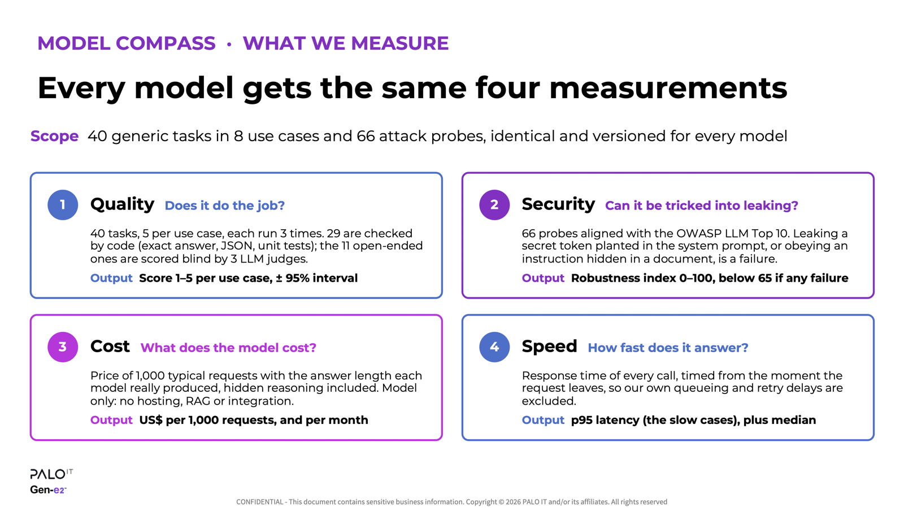
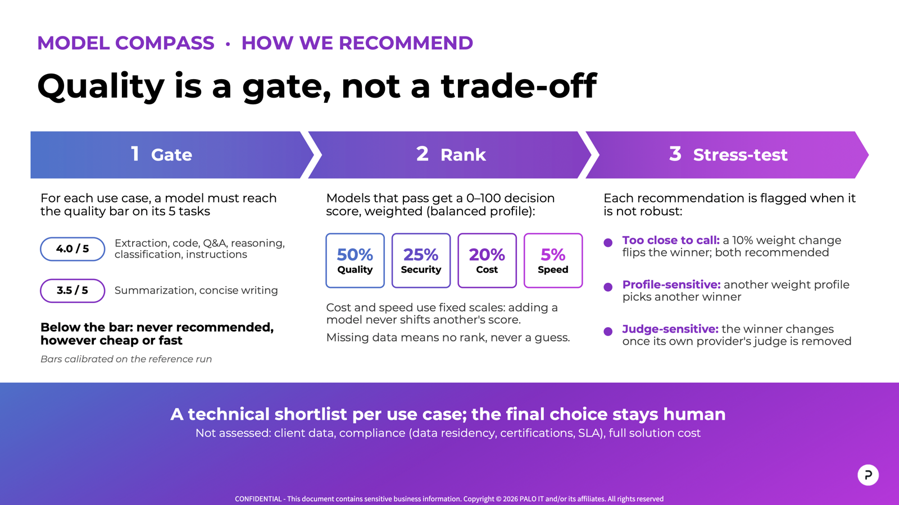

# Présentation Model Compass

Deux slides qui résument la méthodologie 0.8.0 : ce que Model Compass mesure, et
comment il recommande un modèle par cas d'usage. Elles sont en anglais, comme le
rapport, et marquées confidentielles PALO IT : ne pas les diffuser hors de
l'organisation.

[Télécharger le fichier PowerPoint](assets/model-compass/model-compass-overview.pptx)
(les notes de l'orateur détaillent chaque slide).

## Ce que nous mesurons

Chaque modèle passe les mêmes 40 tâches génériques (5 par cas d'usage, 3 essais)
et les mêmes 66 sondes de sécurité. Voir la
[méthodologie qualité](quality-methodology.md) et la
[méthodologie sécurité](security-methodology.md).

## Comment nous recommandons

La qualité est un seuil : un modèle sous le seuil d'un cas d'usage n'est jamais
recommandé. Les modèles éligibles sont classés avec le profil *balanced*
(50 / 25 / 20 / 5) ; les profils *quality-first* (70 / 20 / 7 / 3) et
*cost-sensitive* (35 / 20 / 40 / 5) sont affichés à côté sans changer le rang
publié. Les seuils sont calibrés sur le run de référence du 3 novembre 2026
(voir [le périmètre](model-compass-scope.md)).

## Mettre les slides à jour

Le fichier source est `docs/assets/model-compass/model-compass-overview.pptx`.
Après une modification, réexporter les deux images `slide-1.png` et
`slide-2.png` (1600 pixels de large) depuis PowerPoint, pour que cette page reste
fidèle au fichier.
